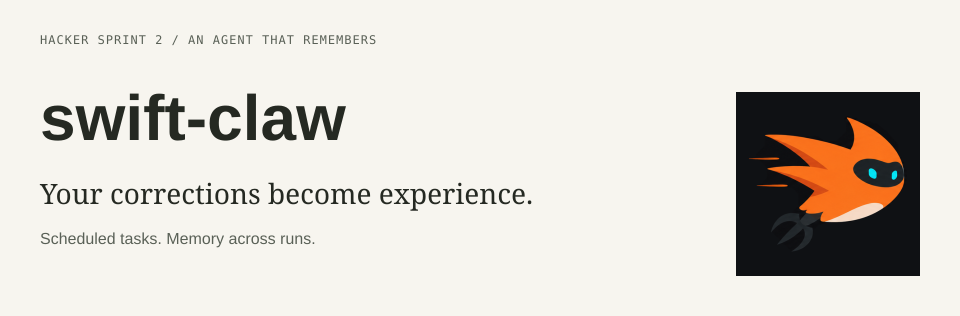
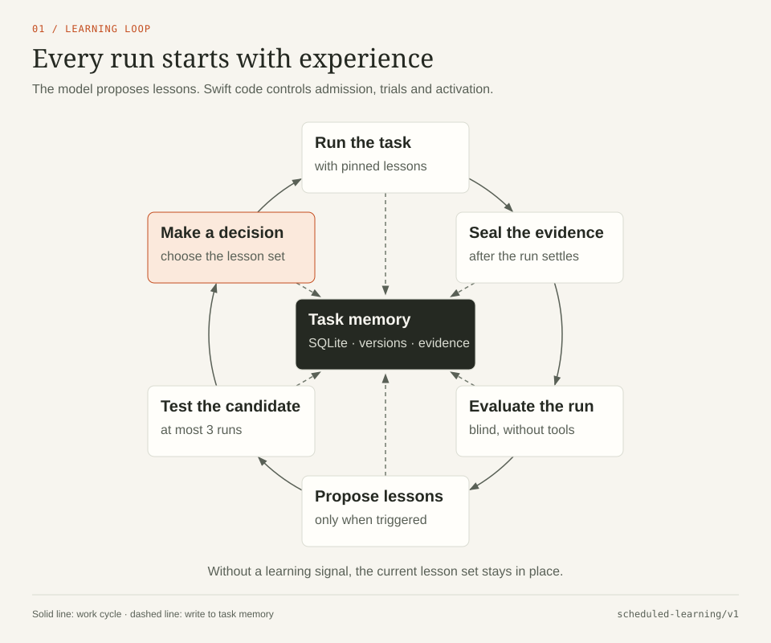
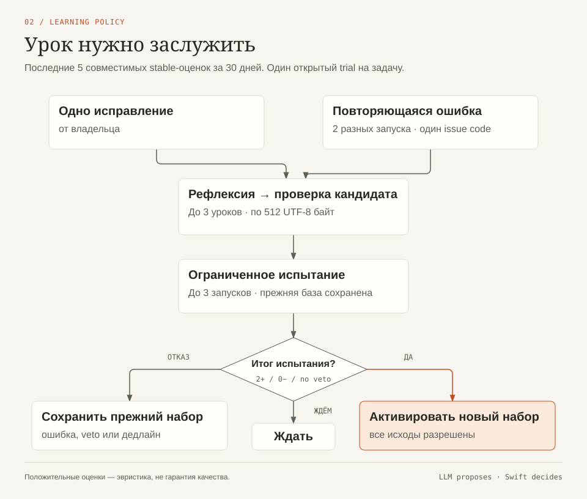
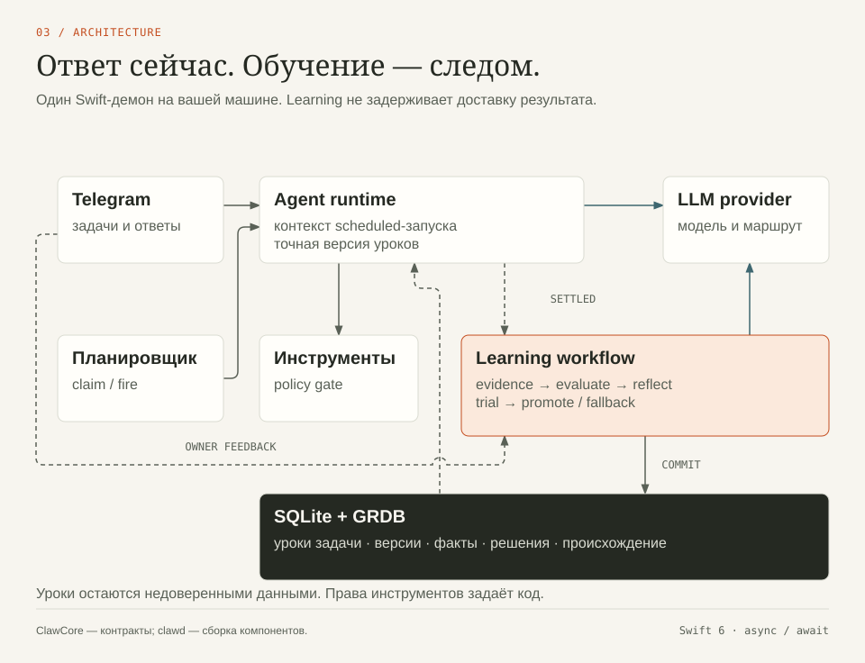

<p align="center">
  
</p>

**swift-claw — персональный AI-ассистент, который выполняет регулярные задачи и превращает ваши исправления в опыт для следующих запусков.**

Вы общаетесь с ним в Telegram. Он работает на вашей машине, помнит контекст и выполняет задачи
по расписанию. За хакатон добавлен цикл обучения: ассистент оценивает результат,
выводит короткие уроки из обратной связи и проверяет их на следующих запусках.

<p>
  <a href="#results">Результаты</a> ·
  <a href="#learning">Алгоритм обучения</a> ·
  <a href="#architecture">Архитектура</a> ·
  <a href="#run">Запустить</a> ·
  <a href="https://github.com/podlodka-ai-club/sharpening/issues/1">Задачи хакатона</a>
</p>

Этот репозиторий — хакатонная версия [swift-claw](https://github.com/ivan-magda/swift-claw).
В `main` находится код ветки самообучения; имя демона — **`clawd`**.
[Dashboard проекта][dashboard] связывает этапы, решения и отчёты.

## Одна задача. Несколько запусков. Накопленный опыт.

Регулярная задача должна учитывать ваши требования и после завершения чата.
Например, мониторинг страницы должен сообщать о существенном изменении цены,
но не отвлекать вас каждым обновлением счётчика или времени доставки.

Первый benchmark проверяет именно это: агент сравнивает две версии страницы,
выделяет существенные изменения и прикладывает подтверждающие фрагменты.
Вот **реальная пара ответов из эксперимента M3**:

| На странице изменилось | Без урока | С выведенным уроком |
|---|---|---|
| Цена: **$12.99 → $9.99** | Сообщить | Сообщить |
| Текущая оценка доставки: **25 → 18 минут** | Сообщить | Пропустить как изменчивый показатель |
| Балл по фиксированной метрике | **85 / 100** | **100 / 100** |

[Исходный ответ][example-clean] · [Ответ с уроком][example-trained] · [Сохранённый урок][candidate]

Смысл урока: часто обновляемые показатели считать шумом, **кроме случаев, когда они отражают
устойчивое изменение цены, доступности, обязательств или срока**. Это правило сохраняется
у конкретной задачи и становится частью контекста будущих запусков.

Механизм общий для повторяющихся задач. Мониторинг страниц — первый измеримый сценарий,
на котором мы проверяли обучение; его результаты и границы приведены ниже.

<a id="results"></a>

## Что показали прогоны

**В M3 кандидат улучшил результат на трёх парных проверках. Последующую проверку
на новом примере он не прошёл.** Это два результата одного эксперимента.

| Проверка | Наблюдение | Вывод |
|---|---|---|
| Три пары: чистый контекст → контекст с уроком | **85 → 100** в каждой паре; средний прирост **+15 баллов** | Урок исправил лишние срабатывания на этих примерах |
| Проверка после promotion, active gate | **30 / 100** при пороге **90**; `material.missed` | На новом примере пропущено существенное изменение |
| Проверка после перезапуска | **Не достигнута** | Этот эксперимент не подтверждает сохранение эффекта после restart |

Источники: [три парных сравнения][pairs], [active gate][active], [итоговый JSON-отчёт M3][report].
Итоговый статус прогона — `incomplete_failed`. Прирост на трёх парах не доказывает устойчивого
улучшения на новых страницах.

В этом прогоне рефлексию запустило **исправление владельца** (`owner_correction`).
Сам evaluator на исходных запусках вернул `no_issue` и проблему не обнаружил:
[решения алгоритма][decisions], [первая оценка][evaluation]. Поэтому результат демонстрирует
обучение с обратной связью владельца; автономное выявление этой ошибки пока не показано.

После эксперимента механизм был интегрирован в демон. Для **M4 проверены все 15 критериев
приёмки на `d784bf91`**: [отчёт с доказательствами][acceptance]. Он подтверждает реализацию
production loop и его контрактов. Живое сравнение чистого и обученного production-агента
остаётся отдельной демонстрацией, которую этот отчёт не заменяет.

<a id="learning"></a>

## Как происходит обучение

<p align="center">
  
</p>

1. **Выполнить задачу.** Запуск получает зафиксированную версию уроков и работает с ней до конца.
2. **Оценить результат.** После завершения сохраняются evidence и оценка. Технический сбой
   не превращается в отрицательную оценку качества.
3. **Найти повторяющуюся проблему.** Два отрицательных результата с одинаковым кодом проблемы
   могут запустить рефлексию. Одного исправления владельца достаточно для более быстрого старта.
4. **Предложить уроки.** Модель формирует короткий набор правил для этой задачи.
   Код проверяет размер, содержимое, происхождение и актуальность кандидата.
5. **Проверить в работе.** Кандидат проходит ограниченный trial. По результатам он заменяет
   стабильные уроки или отклоняется; решения и основания сохраняются.

**Обучение здесь — изменение памяти задачи.** Веса модели не меняются, fine-tuning не нужен.
Версии уроков, оценки, обратная связь и решения живут в SQLite через GRDB.
Внешний сервис памяти, включая xMemory, для этого не используется.

Evaluator работает без инструментов и не видит текст уроков, кандидата и состояние trial.
Reflector получает совместимые результаты, стабильные уроки и обратную связь владельца.
Так оценка и предложение изменений остаются разными этапами.

## Когда урок становится постоянным

<p align="center">
  
</p>

| Правило `scheduled-learning/v1` | Зачем оно нужно |
|---|---|
| Последние **5 совместимых оценок за 30 дней** | Не смешивать результаты разных условий задачи |
| До **3 уроков**, каждый до **512 UTF-8 байт** | Сохранять компактный опыт для следующих запусков |
| Один trial на задачу, до **3 созданных запусков** | Ограничивать воздействие непроверенного изменения |
| **2 положительных** результата, без отрицательных и veto | Принимать кандидата только после разрешения всех назначенных запусков |
| **1 отрицательный** результат или hard veto | Завершать trial, сохраняя прежние стабильные уроки |
| **30 дней** на назначения, **37 дней** на решение | Завершать trial даже при паузах и недостающих оценках |

Указанные сроки — верхние пределы: при достаточных результатах trial завершается раньше.

В Telegram владелец может отметить результат **Useful / Not useful**, внести исправление через
**Correct it**, оспорить оценку, отредактировать или отклонить кандидата и откатить promotion.
Одобрение кандидата не считается положительным результатом запуска.

Уроки входят в контекст как недоверенные данные. Они не могут менять расписание, адресатов,
модель, бюджеты или разрешения инструментов. Существующие policy engine и approval controls
продолжают действовать. Решение о promotion эвристическое; наличие подтверждений владельца
записывается отдельно.

<a id="architecture"></a>

## Как это устроено

<p align="center">
  
</p>

**`clawd` — один демон на Swift 6 со strict concurrency**, который работает на macOS и Linux.
Telegram служит интерфейсом владельца; модели доступны через настраиваемый provider route.
Состояние хранится локально, секреты шифруются на диске.

| Часть системы | Ответственность | Код |
|---|---|---|
| `ClawCore` | Протоколы и типы: задачи, evidence, уроки, trial и решения | [Learning domain](Sources/ClawCore/Domain/Learning) |
| `ClawAgent` | Выполнение задачи, контекст с закреплёнными уроками, LLM и инструменты | [Agent runtime](Sources/ClawAgent) |
| `ClawGateway` | Telegram, расписания, обратная связь и координация learning workflow | [Learning services](Sources/ClawGateway/Services/Learning) |
| `ClawData` | Транзакции, версии уроков, доказательства, promotion, rollback и retention | [Learning store](Sources/ClawData/Stores/Learning) |

Домен и протоколы отделены от реализаций, зависимости собираются в корне `clawd`.
Фиксация уроков на запуске, атомарные переходы и восстановление состояния обеспечивают
предсказуемую работу при конкурентных событиях и перезапусках.

**Экспериментальный контроллер написан на Python** и отделён от Swift-демона. Он задаёт
фиксированные данные, порядок прогонов и детерминированный scorer. Эталонные ответы
не передаются агенту вместе с заданием.
[Архитектура](docs/ARCHITECTURE.md) · [Спецификация алгоритма][algorithm] · [Протокол M3][protocol]

<a id="run"></a>

## Запустить хакатонную версию

Нужны **Swift 6.3**, macOS 15+ или Linux, Telegram-бот и доступ к LLM.
На Linux для сборки установите `libsqlite3-dev`. Собирайте этот репозиторий из `main`:

```bash
git clone https://github.com/podlodka-ai-club/sharpening.git
cd sharpening
swift build -c release
export PATH="$PWD/.build/release:$PATH"
```

[Настройте бота по инструкции](docs/GETTING_STARTED.md#2-configure): скопируйте конфигурацию
из `.env.example`, укажите Telegram token и LLM route, запечатайте секреты и добавьте свой
Telegram ID в `CLAW_ALLOWLIST`. Полный onboarding описывает каждый шаг.

В `~/.swift-claw/clawd.env` включите обучение:

```bash
CLAW_LEARNING_ENABLED=true
```

Загрузите конфигурацию в shell и запустите демон:

```bash
set -a && source ~/.swift-claw/clawd.env && set +a
clawd doctor --check-config
clawd run
```

Learning выключен по умолчанию; изменение настройки требует перезапуска.
Вычисления evaluator и reflector используют настроенную модель и общие лимиты расходов,
включая лимит фоновых задач.
Для обучения используйте личный диалог владельца с ботом.

### Попробовать цикл в Telegram

1. Создайте повторяющуюся задачу через `/schedule <описание задачи и расписания>`
   и подтвердите её. `/schedule list` покажет `jobId`.
2. Выполните `/runnow <jobId>`, нажмите **Correct it** под результатом
   и ответьте, что нужно изменить.
3. Откройте `/learning <jobId>`, чтобы увидеть уроки и состояние trial.
4. Выполните следующие запуски через `/runnow <jobId>` и оцените результаты.
   Положительные и отрицательные оценки участвуют в решении по правилам выше.
5. После promotion кнопка **Roll back promotion** возвращает предыдущий набор уроков.
   `/learning reset <jobId>` с подтверждением начинает новую эпоху с пустым набором.

Это ручной сценарий знакомства с production loop. Записанные измерения M3 доступны
[отдельно][report]. Reset прекращает активное использование уроков, сохраняя историю.

## Документация и материалы

| Что посмотреть | Ссылка |
|---|---|
| Ход работы и текущий статус | [Основная задача #1](https://github.com/podlodka-ai-club/sharpening/issues/1) · [Dashboard][dashboard] |
| Исходный эксперимент и результаты | [Протокол][protocol] · [Парные проверки][pairs] · [Финальный отчёт][report] |
| Production learning: дизайн и приёмка | [Design][production-design] · [M4: 15 критериев][acceptance] |
| Настройка, обучение и команды владельца | [Getting started](docs/GETTING_STARTED.md) · [Customization](docs/CUSTOMIZATION.md#scheduled-learning) |
| Остальные возможности swift-claw | [Обзор продукта](docs/PRD.md) · [Архитектура](docs/ARCHITECTURE.md) |
| Установка сервиса и локальная разработка | [Install](docs/INSTALL.md) · [Local development](docs/LOCAL_DEV.md) · [Testing](docs/TESTING.md) |
| Безопасность и участие в разработке | [Security](SECURITY.md) · [Contributing](CONTRIBUTING.md) |

[MIT](LICENSE) © Ivan Magda

[dashboard]: https://github.com/podlodka-ai-club/sharpening/issues/1#issuecomment-5575295475
[acceptance]: https://github.com/podlodka-ai-club/sharpening/issues/6#issuecomment-5575298657
[example-clean]: experiments/scheduled-task-learning/scheduled-learning-v1/results/task-attempts/task-2/result.json
[example-trained]: experiments/scheduled-task-learning/scheduled-learning-v1/results/task-attempts/task-3/result.json
[candidate]: experiments/scheduled-task-learning/scheduled-learning-v1/results/candidate.json
[pairs]: experiments/scheduled-task-learning/scheduled-learning-v1/results/page-adapter-receipt.json
[active]: experiments/scheduled-task-learning/scheduled-learning-v1/results/active-evidence.json
[report]: experiments/scheduled-task-learning/scheduled-learning-v1/results/final-report.json
[decisions]: experiments/scheduled-task-learning/scheduled-learning-v1/results/events/decision-receipts.json
[evaluation]: experiments/scheduled-task-learning/scheduled-learning-v1/results/learning-calls/evaluator-task-0/result.json
[algorithm]: docs/research/170-generic-scheduled-task-learning-algorithm.md
[protocol]: docs/research/172-validation-protocol.md
[production-design]: docs/ARCHITECTURE.md#141-scheduled-learning-terminal-decisions
